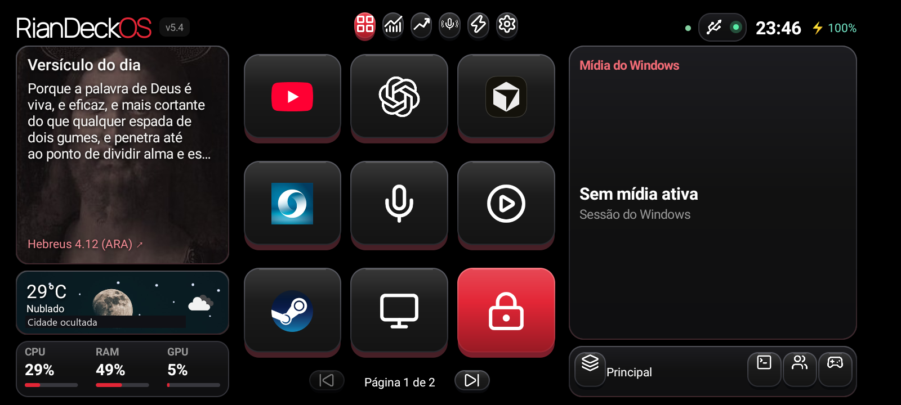

# RianDeckOS 5.4

Painel Android nativo para controlar um notebook Windows por USB. Reúne atalhos, mídia, monitoramento, perfis, automações e um assistente de voz local em português brasileiro. A instalação de referência usa um Moto G20, Android 11 e tela em paisagem de 1600 × 720.

| Objetivo | Guia |
| --- | --- |
| Recriar a instalação | [Instalação e pareamento](docs/INSTALACAO.md) |
| Entender as integrações | [Arquitetura e fluxos](docs/ARQUITETURA.md) |
| Operar, diagnosticar e planejar melhorias | [Operação e direcionamentos](docs/OPERACAO.md) |
| Consultar as telas | [Galeria de prints](docs/PRINTS.md) |
| Configurar e recuperar o modo dedicado | [Quiosque Android](QUIOSQUE.md) |
| Configurar voz local | [Assistente local](ASSISTENTE-LOCAL.md) |
| Entender o avatar em pixel art | [Interface do Assistente](docs/ASSISTENTE-INTERFACE.md) |
| Consultar notícias e indicadores | [Trends e fontes de dados](docs/TRENDS.md) |
| Identificar recursos gráficos | [Créditos](android/assets/CREDITOS.txt) |

O APK Java fica em `android/`. O serviço ASP.NET, o Studio e o assistente ficam em `agent/`. Gere o APK em cada instalação para que o pareamento corresponda ao agente usado pelo telefone.

Veja [Operador Windows 5.2](docs/OPERADOR-5.2.md) para configuração e fluxos do modo assistido.
