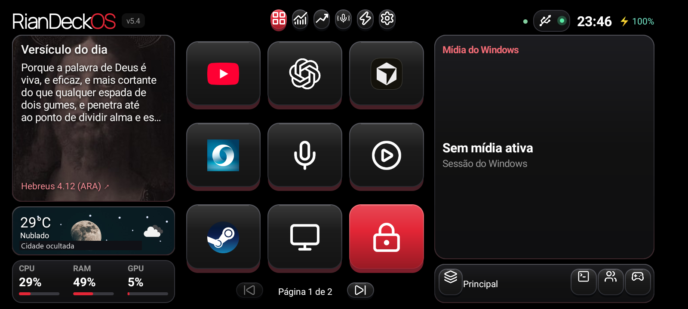
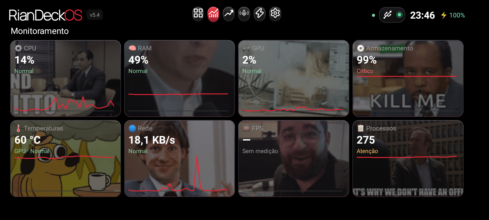
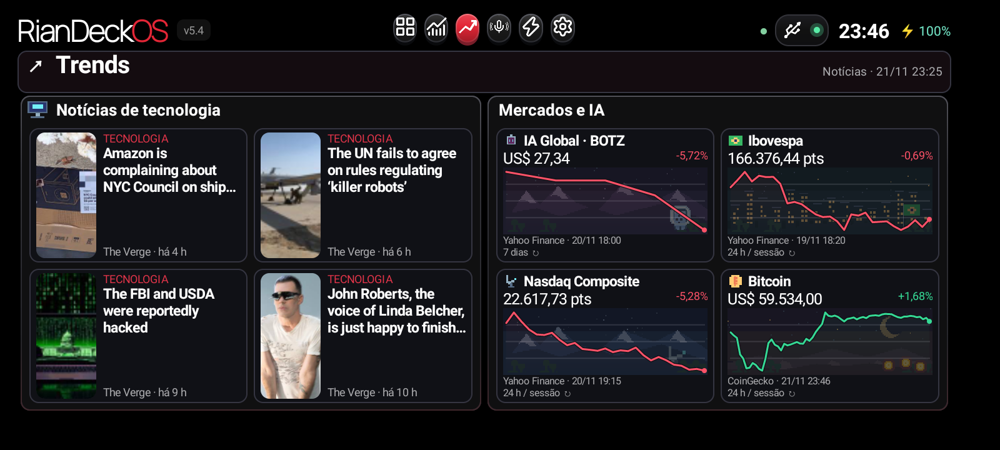
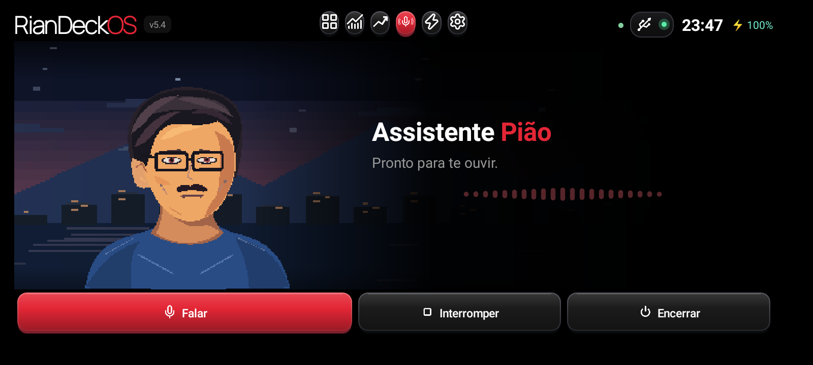
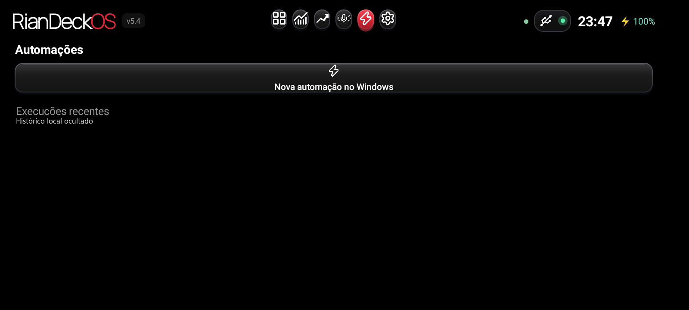
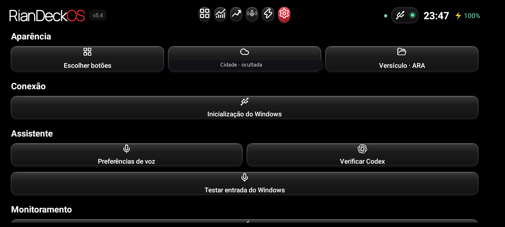

# Prints do RianDeckOS

Capturas do RianDeckOS 5.4 em paisagem no Moto G20. As leituras de monitoramento, notícias e cotações representam o instante da captura. Dados pessoais foram ocultados.

## Controle

## Monitoramento

## Trends

## Assistente Pião

## Automações

## Configurações

